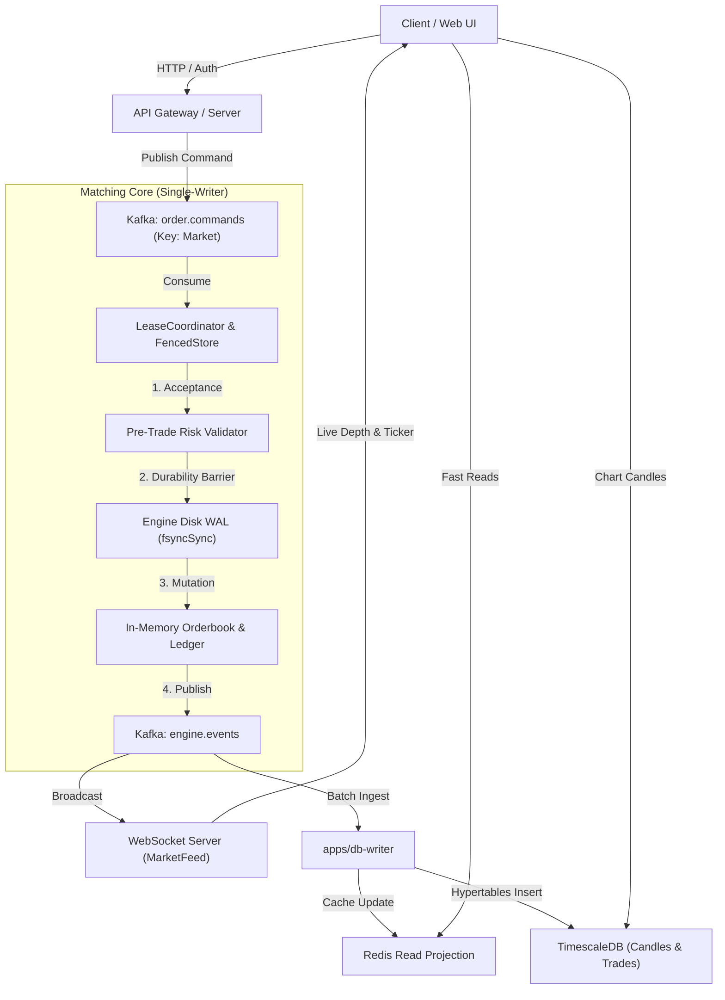

# Persistence Paradigms in Financial Exchanges

A comparative analysis of the persistence mechanisms in the exchange architecture: In-Memory Engine WAL, Kafka Event Streaming, TimescaleDB Hypertables, and Redis Read Projections.

---

## 1. Architectural Overview & Component Matrix

Financial trading systems require competing properties that no single database technology can satisfy simultaneously:
- **Sub-microsecond deterministic matching** (demands pure in-memory execution).
- **Zero data loss on power failure** (demands synchronous sequential disk durability).
- **Decoupled horizontal distribution** (demands partitioned messaging queues).
- **Analytical aggregations for charting** (demands time-series chunked storage).
- **High-throughput sub-millisecond REST reads** (demands in-memory key-value caching).

To satisfy these conflicting requirements, each layer handles a specialized persistence responsibility:

| Property | Engine WAL (`wal.ts`) | Kafka (`order.commands`) | TimescaleDB (`perp_db`) | Redis Cache |
| :--- | :--- | :--- | :--- | :--- |
| **Primary Role** | In-engine crash recovery | Ingress/egress event bus | Analytical store (candles/history) | Fast read projection |
| **Write Latency** | $O(1)$ sequential append (< 5 µs) | 2–5 ms (network batching) | 10–50 ms (disk SQL/MVCC) | < 1 ms |
| **Read Path** | Cold restart replay only | Stream consumer subscriptions | SQL queries (`/candles`, `/history`) | REST endpoints (`/equity`) |
| **Ordering** | Strictly monotonic 64-bit sequence | Per-partition total order | Timestamp ordered | Key-value (eventually consistent) |
| **Concurrency** | Single-writer (zero locks) | Partition-keyed consumer groups | MVCC row-level locking | Concurrent client reads |
| **Durability** | Synchronous `fsyncSync` | In-sync replicas (min.insync.replicas=1) | WAL / checkpoints / fsync | In-memory with RDB snapshot |

---

## 2. End-to-End Data Flow



---

## 3. Why Traditional RDBMS / MVCC Cannot Sit in the Matching Path

In naive exchange implementations, every incoming order runs inside a relational database transaction:
```sql
BEGIN TRANSACTION;
SELECT * FROM balances WHERE user_id = $1 FOR UPDATE;
UPDATE balances SET margin_locked = margin_locked + $2 WHERE user_id = $1;
INSERT INTO orders (...) VALUES (...);
COMMIT;
```

### The Inherent Failures of this Approach:
1. **Lock Contention on Account Balances:** When multiple orders arrive for the same user or market maker, `SELECT FOR UPDATE` blocks the connection pool. Under load, thread starvation cascades.
2. **PostgreSQL MVCC Write Amplification:** Every update creates a new row tuple (`xmax`/`xmin`), requiring table re-indexing and triggering background `VACUUM` worker cycles that introduce unpredictable p99 tail latency spikes (100–500 ms).
3. **Random Disk I/O:** B-tree index updates generate random block writes across storage pages, bounding matching throughput to 2,000–5,000 orders/sec.

**The Solution:** The core engine maintains all active books, positions, and balances in single-threaded memory. Synchronization is replaced by deterministic sequential command processing.

---

## 4. Engine WAL vs. Kafka Log Partitioning

While both use append-only logging, their semantics differ critically:

### Kafka Delivery Semantics vs. Engine Idempotency
- Kafka guarantees **at-least-once** delivery by default. Under network timeouts or broker rebalances, Kafka producers and consumers may replay messages.
- Kafka partitioning alone does not prevent split-brain execution if an old engine experiences a GC pause while a failover engine is promoted.
- The Engine WAL pairs each entry with a **monotonic fencing token** and checks incoming commands against the in-memory `appliedKeys` set. Replayed messages are rejected before state mutation.

### Partitioning Strategy
- Kafka topics (`order.commands`) are partitioned strictly by `market` key (e.g., `BTC-PERP`).
- This guarantees that all commands affecting a single order book arrive in total order at the designated engine partition worker, while independent markets (`ETH-PERP`, `SOL-PERP`) process in parallel across independent workers.

---

## 5. TimescaleDB Hypertables for Historical Analytics

Once events leave the matching engine, durability for querying shifts to TimescaleDB.

### Hypertables Partitioning & Aggregation
- Fills emitted by `engine.events` are ingested in batches by `apps/db-writer` and inserted into the `trades` hypertable.
- TimescaleDB automatically chunks the table into discrete time intervals (e.g., 1-day chunks) based on `executed_at`.
- Time-bucketed SQL aggregates power candlestick intervals (`1m`, `5m`, `1h`, `1d`):
```sql
SELECT
  time_bucket('1 minute', executed_at) AS bucket,
  first(price, executed_at) AS open,
  max(price) AS high,
  min(price) AS low,
  last(price, executed_at) AS close,
  sum(quantity) AS volume
FROM trades
WHERE market = $1 AND executed_at >= $2
GROUP BY bucket
ORDER BY bucket ASC;
```

### Decoupling Analytical Latency
Because all heavy aggregation queries run against TimescaleDB (and lightweight balance lookups run against Redis), the in-memory matching engine runs with zero database dependencies, maintaining microsecond-level determinism at all times.
