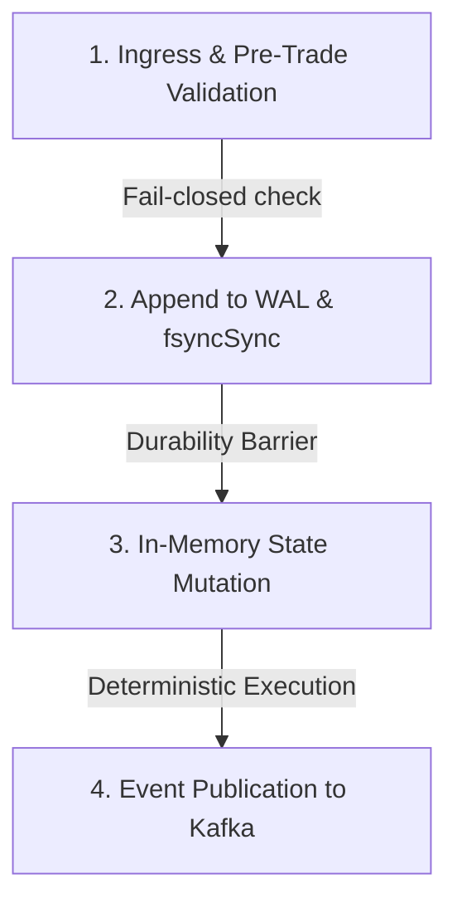

# Rebuilding Exchange State from a WAL

A technical analysis of deterministic crash recovery, synchronous fsync durability barriers, and state snapshot compaction in the perpetual exchange matching engine.

---

## 1. The Core Durability Problem

Financial exchanges operate on in-memory state for microsecond-level matching and pre-trade margin calculations. However, memory is volatile. If the engine process crashes (e.g., `kill -9`, kernel panic, power loss), the in-memory state is lost.

Traditional database transactions (ACID via two-phase commit or MVCC row-locking) introduce millisecond-scale disk roundtrips and lock contention that reduce throughput by orders of magnitude. 

To achieve sub-microsecond matching latency alongside banking-grade financial durability, the engine implements a **deterministic single-writer Write-Ahead Log (WAL)** combined with **periodic state snapshots** and **business-level idempotency**.

---

## 2. The 4-Phase Command Pipeline

To guarantee that no acknowledged transaction is ever lost or mutated inconsistently across a crash, all state modifications flow through a strict 4-phase pipeline (`apps/engine/src/pipeline/DurablePipeline.ts`):

### Phase 1: Ingress & Pre-Trade Validation
The incoming command (`PLACE_ORDER`, `CANCEL_ORDER`, `DEPOSIT`, `WITHDRAW`) is checked against client idempotency keys and pre-trade risk constraints (`apps/engine/src/risk/pre-trade.ts`):
- Non-zero positive quantities and prices.
- Leverage within permissible market limits ($\le 50\text{x}$).
- Account solvency and sufficient available margin.
- Explicit order lifecycle transition validation (`apps/engine/src/core/order-state.ts`).

If validation fails, the command is rejected immediately without allocating sequence numbers or mutating memory.

### Phase 2: WAL Serialization & fsync Barrier
The command is assigned a strictly monotonic 64-bit sequence number, serialized to JSON (with BigInt precision preservation, e.g. `1000000n`), and written to disk. A synchronous flush (`fsyncSync`) guarantees physical persistence onto non-volatile storage before any memory state changes.

### Phase 3: In-Memory State Mutation
The command is applied to the active `Exchange` state:
- Order matching across sorted price levels in `Orderbook`.
- Margin locking, balance updates, and position tracking in `Ledger`.
- Idempotency key recorded in `appliedKeys`.

### Phase 4: Event Publication
Deterministic execution events (`ORDER_ACCEPTED`, `ORDER_FILLED`, `ORDER_CANCELLED`, `COLLATERAL_DEPOSITED`) are pushed to the output channel (`engine.events`) for downstream broadcast via WebSocket and persistence to TimescaleDB.

---

## 3. Crash Recovery Boundaries

The strict 4-phase ordering creates well-defined recovery boundaries:

| Crash Point | Engine State at Crash | Disk WAL State | Action on Replay / Recovery |
| :--- | :--- | :--- | :--- |
| **Boundary 1: Pre-fsync** | Unchanged | Unwritten | Command never existed. Client receives timeout/error and retries cleanly. Zero state drift. |
| **Boundary 2: Post-fsync, Pre-mutation** | Unchanged | Written | WAL replay detects command on boot, mutates state deterministically, produces exact expected balance. |
| **Boundary 3: Post-mutation, Pre-publish** | Mutated | Written | WAL replay recovers state. Downstream event consumers deduplicate via business `fillId` / `orderId`. |

### Handling Corrupted Tail Records (Experiment F7)
In the event of an abrupt power failure during a disk write, the final line in the WAL may be truncated. 

The recovery loader (`WriteAheadLog.replay` in `apps/engine/src/wal/wal.ts`) handles this with defensive line-by-line parsing:
1. Sequentially processes each newline-delimited JSON entry.
2. If the terminal line fails JSON parsing or BigInt schema validation, the engine stops replay at the last valid record.
3. All prior transactions remain 100% intact and valid.
4. Total system balance conservation ($L2$) remains preserved with zero drift.

---

## 4. State Snapshotting & Tail Replay Optimization (P1)

As the WAL grows over days of trading, replaying millions of individual commands from sequence 0 increases recovery time (RTO). 

To optimize recovery, the engine provides snapshot compaction (`apps/engine/src/wal/snapshot.ts`):

1. **Snapshot Creation:** Serializes the entire exchange state (user balances, open positions, resting order books, fee pool, insurance fund, and applied idempotency keys) alongside the exact sequence number $N$.
2. **Boot Restoration:** 
   - Restores base state directly from the snapshot into memory in $O(1)$ relative to trade volume.
   - Replays only the tail delta from sequence $N + 1$ forward.
3. **State Hash Invariance:**
   Both full replay and snapshot + tail replay produce byte-identical SHA-256 state tree hashes:
   - Live / Full Replay Hash: `b1521cb77807c3959b3aff2b96fb0942dcd8eea6bf3e0110afe130cc9ca96d3b`
   - Snapshot + Tail Hash: `b1521cb77807c3959b3aff2b96fb0942dcd8eea6bf3e0110afe130cc9ca96d3b`

---

## 5. Clean-Room Disaster Recovery Metrics (P1)

In failure experiment F10 (`apps/engine/tests/test.disaster-recovery.ts`), disaster recovery was tested by simulating complete loss of the primary node:
1. Primary engine processed 55 transactions and generated snapshot + tail log.
2. A completely fresh, uninitialized standby engine was spun up in an isolated environment.
3. Snapshot was restored and the 20-entry tail was replayed.

### Empirical Results:
- **Recovery Time Objective (RTO):** **2.05 ms** (sub-3ms full restoration).
- **Recovery Point Objective (RPO):** **0 transactions lost** (100% durable).
- **Financial Drift:** **0.00000000 USDT** across all balances, margins, and insurance funds.
- **Standby State Hash:** Byte-identical SHA-256 (`3b68293ede96537b50d5be05e236916bff09b76c7eb83a5d2fe21ce7cf3cd182`).
